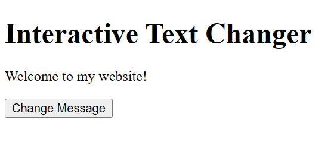
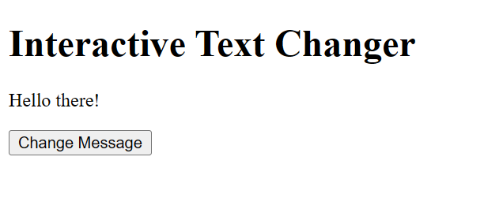
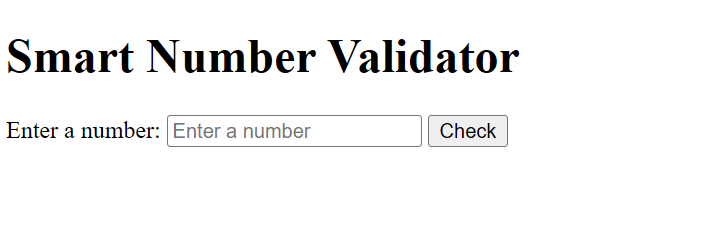
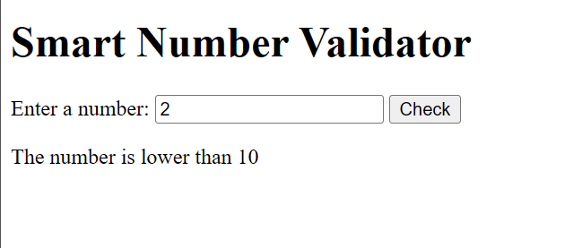
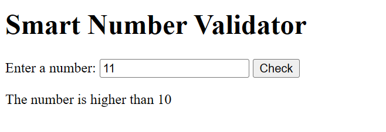
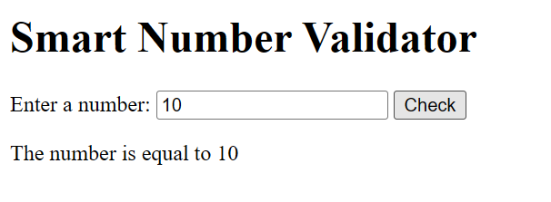
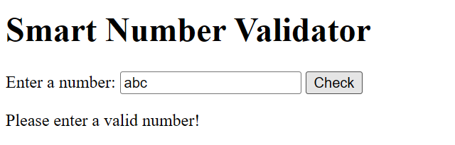
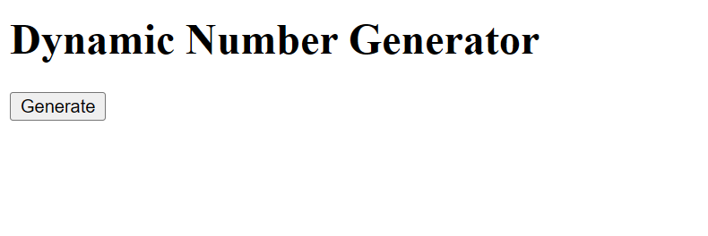
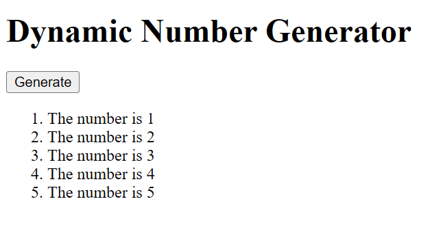

# BIC21203 Web Development - Lab 4a: Client-Side Scripting (JavaScript)

Name: Muhammad Haziq bin nazri
Student ID: AI240032

## Overview

3 small pages that use plain HTML5 and JavaScript (no libraries). Each uses an external
`script.js` loaded with `defer`, `addEventListener()` instead of inline `onclick`, and
`textContent` (never `innerHTML`) for text.

| Folder | Task                     | Key concepts                                                  |
| ------ | ------------------------ | ------------------------------------------------------------- |
| `q1/`  | Interactive Text Changer | DOM selection, function, click event                          |
| `q2/`  | Smart Number Validator   | `trim()`, regex check, `Number()`, if / else if / else        |
| `q3/`  | Dynamic Number Generator | `for` loop, `createElement`, `appendChild`, clearing the list |

## How to run

Open index.html in a desktop browser (double-click or right-click > Open with (selected browser)).

## Test cases

- Q1: load shows "Welcome to my website!"; click shows "Hello there!".
- Q2: `5` lower | `10` equal | `15` higher | `10.5` higher | `abc` invalid | empty / spaces invalid.
- Q3: click shows items 1-5; click again, still exactly 5 items.

## Screenshots

`q1` Before: 
`q1` After: 
`q2` Before: 
`q2` Lower: 
`q2` Higher: 
`q2` Equal: 
`q2` Invalid: 
`q3` Before: 
`q3` After: 
